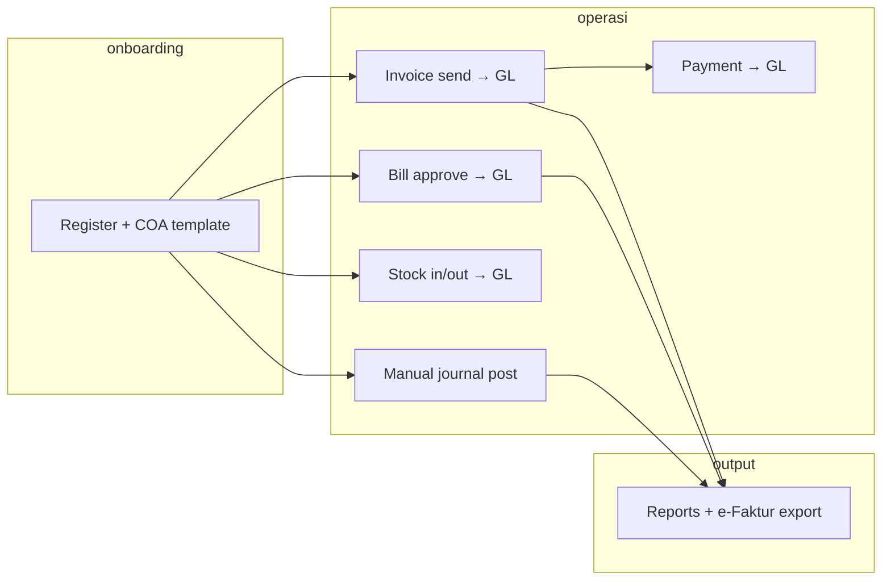

# dnAccounting — Penjelasan Lengkap Fitur

> **Status:** Active · **Last updated:** 2026-10-24 · **Author:** Dozer  
> **Produk:** dnAccounting · **Repo:** `dnFinance/` · **API:** `/api/v1` · **Spek:** PRD/SRS/SDD V2.0

## Summary

Dokumen ini menjelaskan **cara kerja setiap fitur** di dnAccounting — bukan sekadar daftar checkbox. Untuk status implementasi (Available / Conditional / Roadmap) gunakan [FEATURE-CATALOG.md](./FEATURE-CATALOG.md). Untuk endpoint ringkas: [API.md](./API.md) dan Swagger `/api/docs`.

Semua data bisnis **terisolasi per tenant** (perusahaan). Satu user hanya melihat COA, jurnal, invoice, dan laporan milik `tenantId`-nya sendiri.

---

## 1. Identitas, tenant, dan keamanan

### Registrasi perusahaan baru

Pengguna mendaftar lewat `/register` dengan email, password (min. 8 karakter), nama perusahaan, dan **industri**. Sistem membuat:

- **Tenant** baru (company + tier default `growth`)
- **User admin** pertama (pemilik akun)
- **Chart of Accounts** otomatis dari template industri yang dipilih

Industri yang didukung: `retail`, `fnb`, `jasa`, `trading`, `manufac_kecil`. Template COA didefinisikan di package `shared/` (`COA_TEMPLATES`) — masing-masing punya akun Kas, Piutang, Utang, PPN, modal, pendapatan, beban, dll. sesuai pola bisnis.

### Login, sesi, dan logout

- **Login** mengembalikan JWT access token (24 jam) + refresh token (90 hari).
- **Refresh** menukar refresh token valid menjadi pasangan token baru.
- **Logout** menghapus refresh token di server sehingga sesi lama tidak bisa diperpanjang.

Setiap request API (kecuali endpoint publik) membutuhkan header `Authorization: Bearer <token>`.

### Peran (RBAC)

| Role | Tulis transaksi (jurnal, invoice, bill) | Approve bill/jurnal | Admin user | Lihat audit |
|------|----------------------------------------|---------------------|------------|-------------|
| **admin** | Ya | Ya | Ya | Ya |
| **accountant** | Ya | Tidak | Tidak | Ya |
| **manager** | Tidak | Ya | Tidak | Ya |
| **viewer** | Tidak | Tidak | Tidak | TBD (UI terbatas) |

Helper di `shared`: `canRoleWrite`, `canRoleApprove`.

### Tier dan batas user

Setiap tenant punya **tier** (`starter`, `growth`, `pro`, `plus`, `enterprise`). Saat admin menambah user (`POST /admin/users`), jumlah user aktif dibatasi:

| Tier | Maks. user |
|------|------------|
| starter | 1 |
| growth | 3 |
| pro | 10 |
| plus / enterprise | 999 |

Melampaui batas → error `User limit reached`.

### Rate limiting

Semua route dilindungi middleware **100 request/menit** per IP (V2 hardening).

---

## 2. Chart of Accounts (COA)

### Template industri

Setelah registrasi (atau manual `POST /accounts/templates/:industry/apply`), akun dari template ditambahkan **tanpa duplikasi kode**. Admin/accountant bisa melihat daftar template di `GET /accounts/templates`.

### CRUD akun

- **Buat** akun: kode, nama, tipe (`asset` | `liability` | `equity` | `revenue` | `expense`), opsional **department** (dimensi untuk laporan P&L).
- **Update** nama atau nonaktifkan akun (`isActive`).
- **List** bisa difilter per tipe akun.

Saldo akun di UI mencerminkan **akumulasi dari General Ledger** (bukan field statis terpisah setelah posting).

### Import & export COA

- **Import CSV** (`POST /accounts/import`): parse baris kode, nama, tipe; skip jika kode sudah ada.
- **Export CSV** (`GET /accounts/export.csv`): unduh COA tenant saat ini.

### Opening balance

**Import saldo awal** (`POST /import/opening-balances`): untuk setiap baris CSV (kode akun, debit, kredit), sistem menambah transaksi GL dengan referensi `opening` — tanpa jurnal draft terpisah. Berguna saat migrasi dari Excel atau software lain.

### Department (dimensi)

Field `department` pada akun COA dipakai saat **Laba Rugi** di-filter (`GET /reports/p-and-l?department=...`). Daftar department unik: `GET /departments`.

---

## 3. Jurnal manual & General Ledger

### Siklus jurnal manual

1. **Draft** — accountant membuat entri multi-baris; sistem validasi **debit = kredit** dan akun valid (`validateJournalBalance`).
2. **Pending** (opsional) — jika workflow approval aktif, jurnal disubmit ke approver (lihat §9).
3. **Posted** — baris jurnal ditulis ke **GL transactions** dan saldo akun diperbarui.

Status jurnal: `draft` → `pending` → `approved` → `posted`, atau `rejected`.

### Posting jurnal

`POST /journal-entries/:id/post` hanya untuk jurnal **draft** atau **approved** (bukan `pending`). Setelah post, entri tidak bisa diubah; koreksi dilakui lewat jurnal penyesuaian baru.

### General Ledger

`GET /general-ledger` menampilkan semua baris GL tenant dengan filter:

- rentang tanggal (`from_date`, `to_date`)
- kode akun
- pencarian teks di deskripsi/nama akun

Setiap baris menunjuk ke `journal_entry_id` (bisa ID jurnal manual atau referensi dokumen sumber seperti nomor invoice).

### Auto-posting GL (sub-jurnal sistem)

Transaksi operasional **otomatis memposting ke GL** via `postGl()` — tanpa user membuat jurnal manual:

| Sumber | Trigger | Akun tipikal |
|--------|---------|--------------|
| Invoice dikirim | `sendInvoice` | Dr Piutang, Cr Pendapatan, Cr Utang PPN |
| Pembayaran invoice | `recordInvoicePayment` | Dr Kas, Cr Piutang |
| Bill disetujui (semua approver) | `approveBill` | Dr Beban, Dr PPN masukan (jika PKP), Cr Utang, Cr Utang PPh 23 |
| Bill dibayar | `markBillPaid` | Dr Utang, Cr Kas |
| Stock in | `stockMovement` in | Dr Persediaan, Cr Kas |
| Stock out | `stockMovement` out | Dr HPP, Cr Persediaan |

Kode akun standar (`STANDARD_GL_CODES` di `shared`): mis. `1000` Kas, `1100` Piutang, `2100` Utang PPN, `2200` Utang PPh 23, `4000` Pendapatan, `5000` HPP/COGS.

### Template jurnal berulang

User menyimpan **recurring template** (nama, deskripsi, baris jurnal). `POST /recurring-templates/:id/post` membuat jurnal hari ini dari template lalu **langsung post** — cocok untuk accrual bulanan atau penyusutan sederhana.

### Pengaturan approval jurnal

Admin bisa mengaktifkan kebijakan tenant: `POST /settings/journal-approval` dengan `requireJournalApproval: true/false`. Jika aktif, alur submit → approve → post wajib diikuti (§9).

---

## 4. Piutang (Accounts Receivable)

### Master customer

Customer menyimpan nama, email, NPWP/`taxId`, flag **PKP penjual** (`isPvRegistered`). Flag ini menentukan apakah **PPN 11%** dihitung pada invoice.

### Invoice

**Membuat invoice** (`POST /invoices`):

- Line items: deskripsi, qty, harga satuan
- Subtotal = jumlah baris
- PPN = 11% × subtotal **hanya jika** customer PKP (`calculateInvoiceTotals`)
- Nomor otomatis: `INV-YYYYMMDD-NNN`

Status invoice: `draft` → `sent` → `partially_paid` / `paid` / `overdue` / `cancelled`.

**Kirim invoice** (`POST /invoices/:id/send`):

- Status → `sent`
- Email ke customer (simulasi atau Gmail nyata)
- **GL posting** piutang + pendapatan + PPN keluaran

**Pembayaran sebagian/penuh** (`POST /invoices/:id/record-payment`):

- Catat tanggal, jumlah, metode
- Update status `partially_paid` atau `paid`
- GL: Dr Kas, Cr Piutang

**Batch** — `POST /invoices/batch` membuat banyak invoice sekaligus (mis. billing bulanan).

**PDF** — `GET /invoices/:id/pdf` menghasilkan buffer PDF untuk cetak/kirim.

### Aging & overdue

- Saat list invoice, sistem menandai **overdue** jika due date lewat dan masih outstanding.
- Cron scheduler juga memanggil `markOverdueInvoices` (reminder email sekali per invoice jika customer punya email).
- **AR aging** (`GET /reports/ar-aging`): outstanding per customer, bucket 0–30 / 30–60 / 60+ hari.
- **Manual reminder** — `POST /invoices/send-overdue-reminders`.

---

## 5. Utang (Accounts Payable)

### Master vendor

Vendor bisa ditandai **kena PPh 23** (`pph23Applicable`). Import CSV bulk: `POST /import/vendors`.

### Bill (tagihan vendor)

**Membuat bill** (`POST /bills`):

- Subtotal dari line items
- **PPh 23** = 2% × subtotal jika vendor kena PPh 23 (`calculatePph23`)
- **PPN masukan** = 11% × subtotal jika bill dari vendor PKP (`isPkRegistered`)
- **Grand total** = subtotal + PPN masukan − PPh 23 (`calculateBillTotals`)
- Nomor: `BILL-YYYYMMDD-NNN`
- Akun beban default `5100` (bisa override `expenseAccountCode`)

Status awal: `draft`, approval `pending`.

### Workflow approval bill (multi-step)

1. Accountant **submit** (`POST /bills/:id/submit-for-approval`) dengan daftar `approverIds` berurutan.
2. Setiap approver dapat **email** berisi link token (24 jam JWT).
3. Approver bisa approve di app (role manager/admin) **atau** lewat halaman publik `/approve/:token`.
4. **Urutan wajib** — approver order 2 tidak bisa approve sebelum order 1 selesai.
5. Setelah **semua** approve: status bill `approved` + **GL posting** beban, utang, PPh 23, PPN masukan.

**Reject** — satu reject menggagalkan bill (`rejected`).

### Pembayaran utang

- **Mark paid** (`POST /bills/:id/mark-paid`) — hanya bill `approved`; GL Dr Utang, Cr Kas.
- **Schedule payment** — catat rencana bayar untuk **AP forecast** (`GET /reports/ap-forecast`): tagihan jatuh tempo + scheduled payments 30 hari ke depan.

### AP aging

`GET /reports/ap-aging` — outstanding per vendor per bucket umur utang.

---

## 6. Persediaan (Inventory)

### Item master

Setiap item: kode, nama, kategori, satuan, **unit cost**, **reorder level**, stok awal 0.

### Pergerakan stok

| Tipe | Efek stok | Efek GL |
|------|-----------|---------|
| **in** | +qty | Dr Persediaan, Cr Kas (nilai = qty × unit cost) |
| **out** | −qty | Dr HPP, Cr Persediaan |
| **adjustment** | ±qty | Tanpa GL khusus di path adjustment (hanya update qty) |

Stok tidak boleh negatif.

### Alert stok rendah

Jika setelah movement `currentStock < reorderLevel`, sistem mengirim email **LOW_STOCK** (template `email.templates.ts`) ke user yang melakukan movement.

### Laporan inventory

- **Valuation** — qty × unit cost per item, total nilai persediaan.
- **Stock aging** — hari sejak stock-in terakhir, bucket 0–30 / 30–90 / 90+.

**Catatan:** Metode **FIFO/FEFO/AVCO** multi-layer belum ada (roadmap); valuasi saat ini mengandalkan **unit cost** pada master item.

---

## 7. Laporan keuangan & pajak Indonesia

### Trial Balance

Saldo semua akun per tanggal `as_of_date`; total debit harus equal total credit jika buku seimbang.

### Laba rugi (P&L)

Periode default: YTD tahun berjalan. Komponen:

- **Revenue** — net kredit akun tipe revenue (filter department jika ada)
- **COGS** — movement akun kode `5000`
- **Gross profit** = revenue − COGS
- **Operating expenses** — akun tipe expense
- **Net income** = gross profit − expenses

### Neraca (Balance Sheet)

Aset, liabilitas, ekuitas per `as_of_date`; total aset vs liabilitas + ekuitas.

### Arus kas (Cash Flow sederhana)

Agregasi transaksi GL pada akun Kas (kode diawali `10`): receipts (debit), payments (kredit), net cash flow.

### Ringkasan pajak bulanan

`GET /reports/tax-summary?month=&year=`:

- **PPN keluaran** — sum `taxAmount` invoice bulan tersebut
- **PPN masukan** — sum `ppnInputAmount` bill bulan tersebut
- **PPh 23 dipotong** — sum `pph23Amount` bill
- **PPN terutang** = PPN keluaran − PPN masukan
- **Compliance checklist** — task otomatis pertama kali (SPT Masa PPN, SPT PPh 23, e-Faktur export) dengan due date tanggal 20; bisa ditandai selesai via API

Tarif di `shared`: **PPN 11%**, **PPh 23 2%** (bulat ke rupiah).

### Budget vs actual

Admin/accountant set budget per akun per bulan (`POST /budgets`). Laporan membandingkan budget vs actual (actual dari P&L bulan tersebut) — variance = budget − actual.

### Export

| Export | Kegunaan |
|--------|----------|
| **e-Faktur CSV** | Invoice dengan PPN > 0 — upload ke sistem DJP (format helper `buildEfakturCsv`) |
| **GL transactions CSV** | Semua baris GL untuk analisis Excel / import ke Accurate/Jurnal manual |
| **Report PDF** | Trial balance, P&L, atau balance sheet ringkas |

---

## 8. Impor data (onboarding & migrasi)

Halaman **`/import`** dan API:

| Impor | Format | Hasil |
|-------|--------|--------|
| COA | CSV kode, nama, tipe | Akun baru |
| Opening balances | CSV kode, debit, kredit | Baris GL opening |
| Customers | CSV nama, email, taxId | Customer; PKP jika ada taxId |
| Vendors | CSV + flag PPh 23 | Vendor master |

Semua impor mencatat **audit log** (COA import) dan membutuhkan role admin/accountant.

---

## 9. Approval via email & halaman publik

### Token approval

`ApprovalTokenService` menerbitkan JWT **24 jam** berisi: tipe (`bill` | `journal`), `approvalId`, `approverId`, `tenantId`. Link: `{FRONTEND_URL}/approve/:token`.

### Preview tanpa login

`GET /approvals/token/:token` — ringkasan bill (nomor, vendor, amount) atau jurnal (deskripsi, tanggal).

### Keputusan

`POST /approvals/token/:token` body `{ decision: "approved" | "rejected" }`. Token **one-time** (disimpan di `usedApprovalTokens`).

### Jurnal approval (in-app + email)

1. Draft jurnal → `submit-for-approval` → status `pending`, email ke approver.
2. Semua approver approve → status jurnal `approved`.
3. Accountant **post** jurnal (`postJournal`).

Reject jurnal via token: **belum diimplementasi** (error jika reject via email).

---

## 10. Laporan terjadwal (scheduled reports)

User manager/accountant/admin mendefinisikan:

- **reportType** (mis. `p-and-l`, `trial-balance`)
- **frequency** (disimpan; dieksekusi cron scheduler)
- **recipients** (daftar email)

Cron memanggil `runScheduledReports`: generate PDF laporan, enqueue email **SCHEDULED_REPORT**. Pengiriman nyata bergantung Gmail + queue Redis; dev mode → log di `/email-log`.

---

## 11. Dashboard

`GET /dashboard` mengagregasi KPI real-time tenant:

- Jumlah akun COA, invoice open/overdue, bill pending approval
- Item inventory & **low stock count**
- **Revenue MTD** & **net income MTD** (dari P&L YTD slice)
- **PPN payable** bulan berjalan
- **Nilai inventory**
- Jumlah email terkirim (simulasi/nyata)

Dashboard memicu refresh status overdue invoice.

---

## 12. Admin, audit, dan demo

### Manajemen user

Admin melihat daftar user tenant, menambah user dengan role + password. Undangan email (`USER_INVITE` template) di-queue saat user baru.

### Audit trail

`GET /admin/audit-logs` — 100 entri terakhir: create invoice, post journal, approve bill, import COA, dll. (action, entity type/id, user, timestamp).

### Email log (dev & QA)

`GET /email-log` — 50 email terakhir tenant (subject, to, sentAt) — berguna saat Gmail simulasi.

### Mode demo

Startup backend menjalankan `seedDemoCompany`: tenant **PT Toko Sejahtera Nusantara** dengan data contoh (lihat [DEMO-ACCOUNTS.md](./DEMO-ACCOUNTS.md)).

- `GET /demo` — hint kredensial
- `POST /demo/reset` — **hanya** admin `demo@dnaccounting.id`; hapus data tenant demo dan seed ulang

---

## 13. Infrastruktur produk (V2)

Fitur platform yang mendukung modul di atas:

| Komponen | Perilaku dev default | Perilaku production (env set) |
|----------|----------------------|-------------------------------|
| **Persist** | File `.data/store.json` | + snapshot JSONB Postgres jika `DATABASE_URL` |
| **Email** | Simulasi + log | Nodemailer Gmail (`GMAIL_USER`, `GMAIL_APP_PASSWORD`) |
| **Queue** | In-memory jobs | Bull + `REDIS_URL` |
| **Cache** | In-memory Map | Redis; invalidate saat post jurnal |
| **Logger** | Winston structured JSON | Siap forward ke APM (Datadog roadmap) |
| **Health** | `GET /health` flags postgres/email/redis | Monitoring readiness |

`GET /health` versi produk **2.0.0** melaporkan stack flags.

---

## 14. Yang belum / roadmap (jangan dijual sebagai live)

- FIFO / FEFO / AVCO inventory costing
- Cache laporan Redis 5 menit
- PDF invoice di Cloud Storage
- Reject jurnal lewat token email
- OAuth login, mobile native
- Schema relational penuh (86+ entity style ERP) — saat ini model in-memory + snapshot

Daftar lengkap: [FEATURE-CATALOG.md](./FEATURE-CATALOG.md) · [NEXT-PRD-BRIEF.md](./NEXT-PRD-BRIEF.md).

---

## 15. Alur bisnis end-to-end (referensi)

---

## Dokumen terkait

| File | Isi |
|------|-----|
| [REPO-SNAPSHOT.md](./REPO-SNAPSHOT.md) | Keadaan repo & git |
| [USER-GUIDE.md](./USER-GUIDE.md) | Demo 15 menit |
| [ARCHITECTURE.md](./ARCHITECTURE.md) | Diagram komponen |
| [IMPLEMENTATION-STATUS.md](./IMPLEMENTATION-STATUS.md) | % vs spek V2 |
